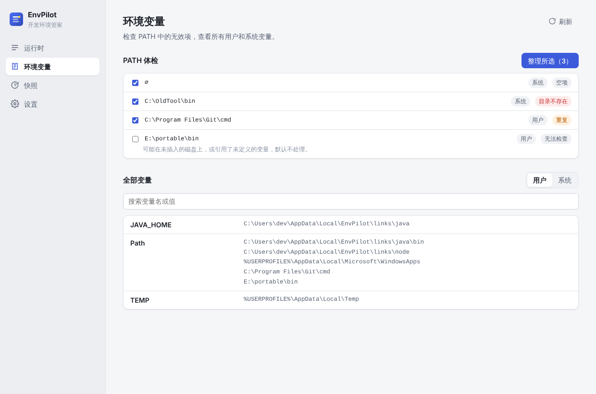
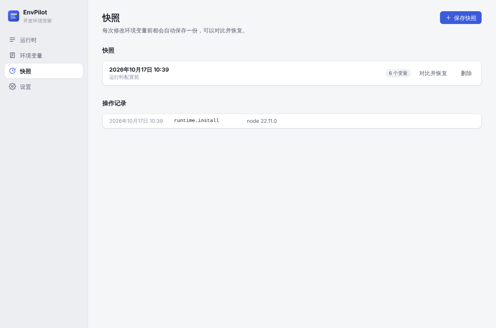
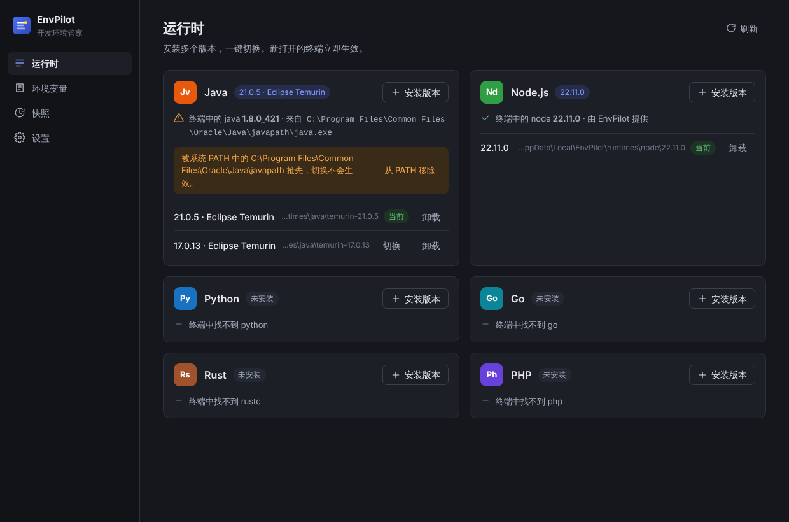

<div align="center">


# EnvPilot

**在 Windows 上管理多个版本的开发运行时，并让 PATH 保持干净。**

Java · Node.js · Python · Go · Rust · PHP

[简体中文](#简体中文) · [English](#english)


</div>

## 简体中文

### 为什么做它

在 Windows 上同时用几个版本的 Java 或 Node，通常意味着手动改 `JAVA_HOME`、在 PATH 里加加删删，然后发现终端里跑的还是某个安装器偷偷塞进系统 PATH 的旧版本。EnvPilot 把这件事变成点一下：装好的版本放在一个地方，切换只改一个链接，并且告诉你终端里实际用的是哪一个。

### 功能

**运行时**

- 从官方源下载，发布方提供了 SHA-256 的都会在安装前校验。
- 不需要管理员权限，默认装在 `%LOCALAPPDATA%\EnvPilot`。
- 每个运行时可以装多个版本，点“切换”即可，新开的终端立刻生效。
- 每张卡片会显示终端里实际解析到的可执行文件。如果系统 PATH 里有别的版本排在前面（例如 Oracle 安装器留下的 `javapath`），会直接指出并可以一键移除。

| 运行时 | 来源 | 校验 |
| --- | --- | --- |
| Java | Eclipse Temurin、Microsoft OpenJDK、Oracle JDK | 有 |
| Node.js | nodejs.org，最新版和各 LTS 版本 | 有 |
| Python | python.org 发布的官方 NuGet 包 | 无（官方未单独发布） |
| Go | go.dev | 有 |
| Rust | rustup，stable / beta / nightly | 有（rustup-init） |
| PHP | windows.php.net，NTS 版本 | 有 |

**环境变量**



- PATH 体检：找出空项、重复项、不存在的目录和多余的引号，逐项勾选后再整理。
- 指向未插入的磁盘或未定义变量的路径标记为“无法检查”，默认不会删除。
- 同时列出用户变量和系统变量，以及它们的原始值。

**快照**



- 每次修改环境变量之前自动保存快照，也可以手动保存。
- 可以查看某个快照和当前状态的差异，并完整恢复，包括删除之后新加的变量。
- “操作记录”列出最近的安装、切换和整理。

**其他**

- 简体中文和英文界面，浅色、深色或跟随系统。
- 可以更换安装目录，选择是否保留下载的安装包。

<details>
<summary>深色模式</summary>



</details>

### 工作原理

```
%LOCALAPPDATA%\EnvPilot
├─ runtimes\java\temurin-21.0.5\     装好的各个版本
├─ runtimes\java\temurin-17.0.13\
└─ links\java  ──►  runtimes\java\temurin-21.0.5   （目录联接）
```

PATH 里只写 `links\java\bin`，`JAVA_HOME` 只指向 `links\java`。切换版本时只把 `links\java` 指向另一个目录，环境变量本身不变，所以不需要重新登录，也不会把 PATH 越改越乱。Node、Python、Go、Rust（`CARGO_HOME`、`RUSTUP_HOME`）和 PHP 都是同样的做法。

### 安全原则

- 读写注册表时保留原始值和类型（`REG_EXPAND_SZ`），不会把 `%USERPROFILE%` 这样的引用写死成绝对路径。
- 只有修改系统级变量时才请求管理员权限，由 Windows 弹出 UAC 确认。
- Windows 目录下的 PATH 项永远不会被提议删除。
- 任何修改都先保存快照，再一次性写入。

### 下载

到 [Releases](https://github.com/xiaohaowen21/envpilot/releases) 下载安装版或便携版，需要 Windows 10 1803 或更新版本。在 0.2 正式发布之前，最新构建可以在 [Actions](https://github.com/xiaohaowen21/envpilot/actions) 里每次运行的 `EnvPilot-windows` 附件中下载。

从 0.1.x 升级前请先看 [已知问题](./KNOWN_ISSUES.md)：旧版本装的运行时不会自动迁移。

### 常见问题

- **切换后终端里版本没变？** 已经打开的终端和程序（包括部分 IDE）保留启动时的环境，重新打开即可。
- **运行时卡片提示“被系统 PATH 中的……抢先”？** 说明系统 PATH 里有另一个同名程序排在前面。可以在卡片上直接移除那一项；它属于系统变量，所以会弹出 UAC。
- **首次启动出现 SmartScreen 提示？** 目前的构建没有代码签名，选择“仍要运行”即可。
- **卸载 EnvPilot 前要做什么？** 先在应用里卸载各个运行时，EnvPilot 会把自己加的 PATH 项和变量一并移除。

### 开发

```bash
npm install
npm run dev            # Electron 开发模式（需要 Windows）
npm run dev:renderer   # 只启动界面，用示例数据在任意系统的浏览器里预览
npm run check          # lint + 测试 + 构建
npm run dist:win       # 打包安装版和便携版
```

| 目录 | 内容 |
| --- | --- |
| `electron/core` | 纯逻辑：PATH 解析、命令解析顺序、变更计划、版本目录解析，全部有单元测试。 |
| `electron/platform` | 和 Windows 打交道的部分：注册表、PowerShell、目录联接、解压，在 Windows CI 上做集成测试。 |
| `electron/services` | 把上面两层组合成具体功能：安装、切换、快照、设置。 |
| `electron/ipc.ts` | 所有 IPC 通道，参数用 zod 校验，修改类操作串行执行。 |
| `shared` | 主进程和界面共用的类型、错误码和 API 定义。 |
| `src` | React 界面，按页面拆分，文案在 `src/locales`。 |

贡献方式见 [CONTRIBUTING.md](./CONTRIBUTING.md)，后续计划见 [ROADMAP.md](./ROADMAP.md)。

---

## English

### Why

Using several Java or Node versions on Windows usually means editing `JAVA_HOME` by hand, adding and removing PATH entries, and then finding that your terminal still runs an old version some installer slipped into the system PATH. EnvPilot turns that into a click: versions live in one place, switching changes a single link, and the app shows you which executable your terminal really runs.

### Features

**Runtimes**

- Downloaded from official sources and verified against the publisher's SHA-256 wherever one exists.
- No administrator rights needed; installed under `%LOCALAPPDATA%\EnvPilot` by default.
- Install several versions of each runtime and switch with one click. New terminals pick up the change at once.
- Each card shows the executable your terminal actually resolves. If another version comes first on the system PATH (such as Oracle's `javapath`), EnvPilot says so and can remove that entry.

| Runtime | Source | Checksum |
| --- | --- | --- |
| Java | Eclipse Temurin, Microsoft OpenJDK, Oracle JDK | Yes |
| Node.js | nodejs.org, latest and LTS lines | Yes |
| Python | The official NuGet package published by python.org | No (none published) |
| Go | go.dev | Yes |
| Rust | rustup, stable / beta / nightly | Yes (rustup-init) |
| PHP | windows.php.net, NTS builds | Yes |

**Environment**

- PATH check-up: finds empty, duplicate, missing and quoted entries; you pick what to fix.
- Entries it can't verify (an unplugged drive, an undefined variable) are marked as such and never removed by default.
- Lists user and system variables with their raw values.

**Snapshots**

- Taken automatically before every change, or on demand.
- Compare any snapshot with the current state and restore it completely, including removing variables added since.
- An activity log of recent installs, switches and clean-ups.

**Also**

- Simplified Chinese and English; light, dark or system theme.
- Choose the install folder and whether to keep downloaded archives.

### How it works

Every runtime has one directory junction, `links\<name>`, pointing at the active version. PATH only contains `links\java\bin`, and `JAVA_HOME` only points at `links\java`. Switching retargets the junction and leaves environment variables untouched, so there is no need to sign out and PATH never accumulates stale entries. Node, Python, Go, Rust (`CARGO_HOME`, `RUSTUP_HOME`) and PHP work the same way.

### Safety

- Registry values are read and written raw and keep their type (`REG_EXPAND_SZ`), so references like `%USERPROFILE%` are never flattened into absolute paths.
- Administrator rights are requested through UAC only when system variables change.
- PATH entries inside the Windows folder are never offered for removal.
- Every change is snapshotted first, then written in a single step.

### Download

Get the installer or the portable build from [Releases](https://github.com/xiaohaowen21/envpilot/releases). Requires Windows 10 1803 or later. Until 0.2 is released, the latest build is attached as `EnvPilot-windows` to each run under [Actions](https://github.com/xiaohaowen21/envpilot/actions).

Upgrading from 0.1.x? Read [KNOWN_ISSUES.md](./KNOWN_ISSUES.md) first: runtimes installed by 0.1 are not migrated.

### FAQ

- **The version didn't change in my terminal.** Terminals and programs that were already open (including some IDEs) keep the environment they started with. Open a new one.
- **A card says another executable shadows EnvPilot's.** Another program with the same name comes first on the system PATH. Remove that entry from the card; it is a system variable, so Windows asks for UAC.
- **SmartScreen warns on first launch.** Builds are not code-signed yet. Choose "Run anyway".
- **Before uninstalling EnvPilot,** uninstall your runtimes in the app; that also removes the PATH entries and variables EnvPilot added.

### Develop

```bash
npm install
npm run dev            # Electron in development mode (Windows)
npm run dev:renderer   # UI only, with sample data, in any browser on any OS
npm run check          # lint + tests + build
npm run dist:win       # build the installer and the portable app
```

The code is organised as in the table in the Chinese section: pure, unit-tested logic in `electron/core`; Windows integration in `electron/platform`, tested on the Windows CI runner; features in `electron/services`; validated IPC in `electron/ipc.ts`; shared types in `shared`; and the React UI in `src`. See [CONTRIBUTING.md](./CONTRIBUTING.md) and [ROADMAP.md](./ROADMAP.md).

## License

[MIT](./LICENSE)
